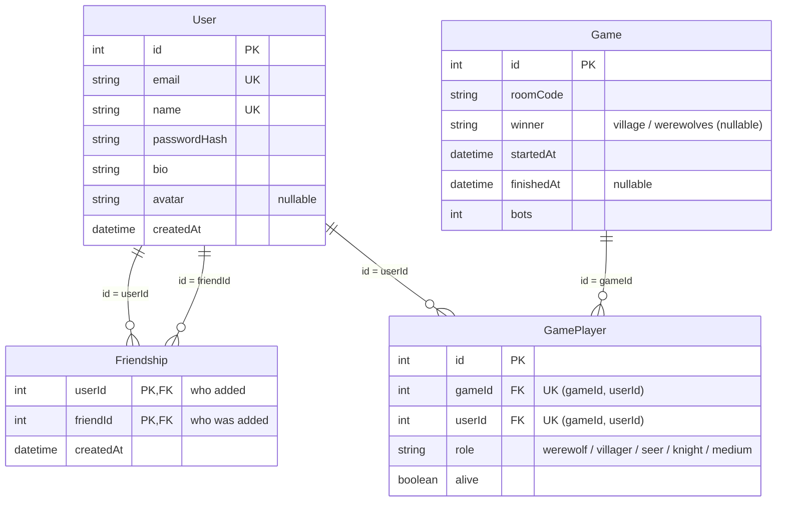

*This project has been created as part of the 42 curriculum by hyamaoka, riyano, raosmona, amakino, takawaka.*

# Werewolf

## Description

**Werewolf** is a real-time online social deduction game. A host creates a room and
shares the invite link; every player opens it on their own phone or computer and
secretly receives a role card. The village must find and vote out the werewolves
before the werewolves eat everyone.

Key features:

- **Secret roles on every device** — werewolf, villager, seer, knight, and an optional
  medium. The role card is face down and only shows while you press and hold it, so
  neighbours can't peek.
- **Night / day / vote phases** with timers, private werewolf chat at night, seer and
  medium results only visible to that player, knight protection (never the same player
  two nights running), runoff on a tied vote, win detection.
- **After death**: last words written while alive are read out, and the dead keep talking
  in a dead chat the living never receive during the game. When the game ends, every
  channel becomes readable to everyone, and a **recap** shows every night's attack, guard
  and inspection, and every ballot.
- **AI players** that use only what their seat can see, make seer claims (true or
  fake), and can chat through Google Gemini (optional) with streamed replies.
- **Live chat**, profiles with avatars, friends with online status and **lobby invites**,
  statistics, achievements, match history and a leaderboard.
- **Game settings**: number of werewolves, seer / knight / medium on or off, phase
  durations, vote reveal, a table theme (classic, blood moon, or snow), and the language
  the bots speak. The host can remove a player from the lobby.
- **Reconnection**: a dropped phone gets its seat, role and chat back. During a game,
  someone who stays away past 20 seconds keeps their seat but no longer holds up the day
  or the vote. In the lobby, their seat is freed after 20 seconds.
- **3 languages**: English, 日本語, Français.
- **Procedural chiptune** music per phase and sound effects (Web Audio API, no audio files).

## Instructions

### Prerequisites

- Docker with Docker Compose v2
- GNU make
- `openssl` (used by `make` to create `.env` on the first run)
- Node.js 22 (only for the server unit tests, `cd server && npm test`)
- A recent Google Chrome

### Run

1. Clone the repository and enter it:

   ```bash
   git clone <repository URL> werewolf
   cd werewolf
   ```

2. Create `.env` with random secrets (an existing `.env` is kept):

   ```bash
   make .env
   ```

   Optional: to let the bots chat through Gemini, put your key in it now
   (`GEMINI_API_KEY=...`, see [Gemini API](#gemini-api-optional)). The server reads `.env` only
   when it starts.

3. Build and start everything, including the public tunnel (`make` also creates `.env` if step 2
   was skipped):

   ```bash
   make
   ```

4. It prints a `https://xxxx.trycloudflare.com` URL: open it, or <https://localhost:8443> on this
   machine (the certificate is self-signed: accept the browser warning).

Other commands: `make up` (the app only, without the tunnel: reachable from this machine only),
`make url` (print the tunnel URL again), `make e2e` (starts the app, then runs end-to-end checks
against it), `make logs`, `make ps`, `make down` (stops everything, including the tunnel), `make re`
(stops, then runs `make` again), `make fclean` (also deletes the database, the uploaded avatars and the locally
built images).

Server unit tests (no database needed): `cd server && npm test`.

### Play together (same Wi-Fi or anywhere)

`make` prints a `https://xxxx.trycloudflare.com` URL (it changes on every
start). Share it, or open a room from it and let the others scan the room's QR code. When you are done, `make down` stops the tunnel together with the app.

### Environment variables (.env)

`.env` is created from the template `.env.example`. `make` does this on the first run and puts a
random `POSTGRES_PASSWORD` and `JWT_SECRET` in it; an existing `.env` is never overwritten.
To create it by hand instead:

```bash
cp .env.example .env
```

Then replace `POSTGRES_PASSWORD` and `JWT_SECRET` with your own random values (for example
`openssl rand -hex 32`). If the database already exists, run `make fclean` before changing
`POSTGRES_PASSWORD`: the database keeps the password it was created with.

| Variable | Meaning |
|---|---|
| `POSTGRES_USER`, `POSTGRES_PASSWORD`, `POSTGRES_DB` | Database credentials |
| `JWT_SECRET` | Secret used to sign session tokens |
| `MIN_PLAYERS` | Minimum players (humans + bots) to start, default 4 |
| `NIGHT_SECONDS`, `DAY_SECONDS`, `VOTE_SECONDS` | Default phase durations in the lobby: 20 / 60 / 20 in `.env.example` (45 / 90 / 30 if unset) |
| `GEMINI_API_KEY` | Optional. Enables LLM bot chat. Free key: <https://aistudio.google.com/apikey> |
| `GEMINI_MODEL` | Optional, default `gemini-3.5-flash-lite` |
| `LLM_REQUESTS_PER_MINUTE` | Optional, default 10 |

Without `GEMINI_API_KEY`, bots use built-in sentences and nothing is sent to Google.

#### Gemini API (optional)

1. Open <https://aistudio.google.com/apikey>, sign in with a Google account and press
   **Create API key**.
2. Put the key in `.env`:

   ```
   GEMINI_API_KEY=your_api_key
   ```

3. Start the app with `make`, or restart it with `make re` if it is already running (the server
   reads `.env` only when it starts; a restart gives a new tunnel URL).
4. Check: start a game with bots and mention a bot in the day chat (for example `Bot 1, are you
   the wolf?`). With the key, the reply appears little by little as it is generated; without it,
   a built-in line appears at once. If something goes wrong, `make logs` shows
   `LLM request failed`. When Google answers with an error, the message has the HTTP status
   (`Gemini HTTP 400`: bad key or bad request, `403`: the key may not use the Gemini API, `429`:
   free-tier limit reached). A request still running after 15 seconds in all, streaming included,
   is cancelled and logged as `The operation was aborted due to timeout`. When the server's own
   limit (`LLM_REQUESTS_PER_MINUTE`) is reached, the bot uses a built-in line without logging
   anything.

> ⚠️ `.env` is ignored by Git (`.gitignore`); only `.env.example` is committed. Never commit
> `.env` or a real key such as `GEMINI_API_KEY`.

## Team Information

Five members. Everyone is also a developer and implements their own modules.

| Member | Role | Responsibilities |
|---|---|---|
| `hyamaoka` | Product Owner, Developer | Product vision and priorities, and the main contact with the evaluators. Game rules: night, day and vote, how a phase ends, win conditions, tied votes, roles and role cards, last words, the post-game recap, the game settings, and the room QR code. Wrote the first version of the privacy policy and the terms, and reviews them. Presents the web game and customization |
| `raosmona` | Project Manager, Developer | Organizes the team, the README and the Git workflow (who commits what, and when). Chat and friends on the screen, lobby invites, English / Japanese / French, the privacy policy and the terms, and the phase music. Presents user-to-user interaction (with `riyano` for the profile) and multiple languages |
| `riyano` | Technical Lead, Developer | Architecture and stack: server, database, Docker, HTTPS, sign-up and login, sessions, profiles, avatars, statistics, and the leaderboard. Presents the frameworks, the ORM, user management, and game statistics |
| `amakino` | Developer | Bot decisions, the built-in lines and chat reading (`server/src/lines.js`), the bots' speech in `server/src/rooms.js`, and Gemini chat. Presents the AI opponent and the LLM interface |
| `takawaka` | Developer | Real-time rooms: what each phone is allowed to see, chat and invite delivery, online status, reconnection, and the server as the single source of truth for every player; the end-to-end tests. Presents WebSockets, remote players, and the multiplayer game |

## Project Management

The work is split by module across the five roles above. Each member implements and
presents their own modules. Everyone can explain the whole game, not only their part.

- Until 2026-10-04, each member built a feature on its own branch (`feat/<topic>`, for example
  `feat/chat` or `feat/game-rules`), and another member merged it into `main`, mostly through a
  GitHub pull request. On 2026-10-06, the reworked assignments and the fixes from a review of the
  whole source were brought into `main` in one merge (`sync/werewolf`, recorded in
  [`docs/TASKS.md`](docs/TASKS.md)). Since then, each member commits their own module directly to
  `main`. Every message says what changed and why. The files are split by module, so changes
  rarely overlap.
- Commit messages: we use [Conventional Commits 1.0.0](https://www.conventionalcommits.org/en/v1.0.0/)
  (`type: description`, for example `feat:`, `fix:`, `docs:`, `chore:`, `test:`). Some early commits
  are looser than this.
- `server/src/rooms.js` is shared by `takawaka` and `amakino` (the bots' speech is `amakino`'s,
  the rest is `takawaka`'s); changes to it are announced in the team chat first.
- The team meets weekly. Each person explains their part out loud, and the others ask
  questions.
- Project management tools: Markdown documents in the repository, versioned with Git like the code:
  - [`docs/TASKS.md`](docs/TASKS.md): the task board, grouped by the five areas of work above, with
    the files each owner is responsible for and the bugs fixed in the review. Each task
    has an owner, a start date, a completion date, a status (done / in progress / not started /
    optional) and the pull request or branch that delivered it. Dates come from the Git history.

  A member who starts or finishes a task updates its row, in the same commit as the work when
  possible, so the board and the history stay in sync.
- Communication: Discord for day-to-day messages, and face-to-face talks for decisions and
  reviews.

## Technical Stack

| Layer | Choice | Why |
|---|---|---|
| Frontend | React 19 + Vite, React Router | Component model fits a UI driven by live state; fast dev server |
| Styling | Tailwind CSS 4 | Responsive utility classes; one small CSS file (`client/src/index.css`) for the card flip, animations and table themes |
| Backend | Fastify 5 (Node.js) | Fast, with built-in JSON schema validation: every JSON route checks its input against a schema (an avatar upload is checked by its size and its first bytes instead) |
| Real time | Socket.IO | Rooms, acknowledgements and automatic reconnection |
| Database | PostgreSQL 17 | Relational data (users, friendships, games, players) |
| ORM | Prisma 6 | Typed schema and relations in one file; `prisma db push` applies it when the app starts |
| Auth | bcrypt (`bcryptjs`) + JWT in an httpOnly, secure cookie | Salted password hashes; token not readable by scripts |
| AI | Google Gemini API (optional) | Free tier, streaming responses |
| Deployment | Docker Compose, Cloudflare Tunnel (optional) | One command to run; public HTTPS URL for parties |
| Other libraries | `qrcode`, `@fastify/multipart`, `@fastify/static` | The room QR code is drawn in the browser, so the link is never sent to a QR service; avatar uploads; serving the built frontend and the avatars |

## Database Schema



| Table | Columns |
|---|---|
| `User` | id, email (unique), name (unique), passwordHash, bio, avatar, createdAt |
| `Friendship` | userId → User, friendId → User, createdAt; primary key (userId, friendId) |
| `Game` | id, roomCode, winner (`village` / `werewolves`), startedAt, finishedAt, bots |
| `GamePlayer` | id, gameId → Game, userId → User, role, alive; unique (gameId, userId) |

### Foreign keys

Each line in the diagram is one foreign key: a column of the child table holds the `id` of a row
in the parent table. A label reads `parent column = child column`; for example, `id = gameId`
between `Game` and `GamePlayer` means `Game.id = GamePlayer.gameId`.

| Foreign key (child) | References (parent) | Cardinality | When the parent row is deleted | Meaning |
|---|---|---|---|---|
| `Friendship.userId` | `User.id` | N : 1 | this row is deleted too (Cascade) | the user who added the friend |
| `Friendship.friendId` | `User.id` | N : 1 | this row is deleted too (Cascade) | the user who was added |
| `GamePlayer.gameId` | `Game.id` | N : 1 | this row is deleted too (Cascade) | the game this seat belongs to |
| `GamePlayer.userId` | `User.id` | N : 1 | this row is deleted too (Cascade) | the user who sat in this seat |

### Relationships

| Relationship | Kind | Meaning |
|---|---|---|
| `User` 1 ─ N `GamePlayer` N ─ 1 `Game` | many-to-many through `GamePlayer` | A user plays many games and a game has many players. Each `GamePlayer` row is one seat: who sat there, which role they had, and whether they survived. A user sits at most once per game (unique (gameId, userId)). |
| `User` 1 ─ N `Friendship` N ─ 1 `User` | many-to-many of `User` with itself | A row means "userId added friendId". Adding needs no consent, so the row is one-way. When both rows exist the two users are mutual friends, and only mutual friends can invite each other to a lobby. |

- **Life of a game**: when the host starts, one `Game` row and one `GamePlayer` row per human are
  created in a single write. When the game ends, `winner` and `finishedAt` are set and the dead
  get `alive = false`. A game that never ended keeps `finishedAt` empty and is left out of the
  statistics.
- **Bots** have no account, so they have no `GamePlayer` row; `Game.bots` only counts them.
- **Statistics, levels, achievements and the leaderboard** have no table of their own. They are
  computed from `GamePlayer` joined with `Game` (`server/src/stats.js`), so they always match the
  match history.
- `GamePlayer.userId` is indexed for the profile statistics.

Live room state (players, roles, chat) is kept in server memory and never sent in full
to clients: each player receives only the public state plus their own private view.

### Example: one finished game

`alice`, `bob` and `carol` played with two bots, and the village won. The database then holds:

`Game`

| id | roomCode | winner | startedAt | finishedAt | bots |
|---|---|---|---|---|---|
| 7 | `k7q2xm` | `village` | 2026-10-17 21:02 | 2026-10-17 21:10 | 2 |

`GamePlayer` (`gameId = 7` points to the game above, and `userId` to a row of `User`)

| id | gameId | userId | role | alive |
|---|---|---|---|---|
| 20 | 7 | 1 (`alice`) | `werewolf` | false |
| 21 | 7 | 2 (`bob`) | `seer` | true |
| 22 | 7 | 3 (`carol`) | `villager` | false |

A seat won when the team of its role is the game's `winner`: `werewolf` is on `werewolves`, and
every other role is on `village` (`TEAM` in `server/src/roles.js`). So `alice` lost, `bob` won and
survived, and `carol` won despite being killed at night. The two bots have no rows; `bots = 2`
only counts them. The profile of `bob` reads every `GamePlayer` row with `userId = 2`, together
with the `Game` row that its `gameId` points to, and counts only finished games.

## Features List

| Feature | What it does | Owner |
|---|---|---|
| Sign up / log in, sessions | Email + password accounts; bcrypt hashes; JWT in an httpOnly cookie; repeated failed logins are locked out for a while | `riyano` |
| Rooms, invite links, lobby, host controls | Create a room, share its link, add or remove bots, remove a player, start the game | `takawaka` |
| Game engine (phases, roles, win conditions) | Night, day and vote with timers; attacks, guards, inspections; runoff on a tie; win detection | `hyamaoka` |
| Role cards (SVG art, press to reveal) | The card shows only while it is pressed (pointer or keyboard) | `hyamaoka` |
| Chat (public, werewolf and dead channels) | Each message goes only to the players allowed to read it; at most 5 messages per 10 seconds per seat (a second tab does not raise it) | `raosmona` (delivery: `takawaka`) |
| Last words, post-game recap | Last words are read out on death; after the game, every night action and every ballot is shown | `hyamaoka` |
| Bots (AI opponent) | Fill empty seats, act only on what their seat can see, claim or fake-claim seer, read claims and suspicions from the chat, announce their vote | `amakino` |
| LLM bot chat with streaming | With a Gemini key, bots answer players and the reply appears as it is generated; built-in lines otherwise | `amakino` |
| Profiles, avatars, statistics, leaderboard | Edit name and bio, upload or remove an avatar (default image otherwise); wins, level, achievements, match history, ranking | `riyano` |
| Friends, online status and lobby invites | Add or remove friends, see who is online, invite online mutual friends to a lobby | `raosmona` (presence and invite delivery: `takawaka`) |
| Game settings | Werewolf count, seer / knight / medium, phase durations, vote reveal, table theme, bot language | `hyamaoka` |
| Room QR code | In the lobby, shows the room's link as a QR code so players at the same table join by scanning the host's screen; drawn in the browser, and replaced by a hint to use the URL that `make` prints when the page is open on localhost | `hyamaoka` |
| Reconnection | A dropped phone gets its seat, role and chat back; a player away for 20 seconds no longer holds up the game | `takawaka` |
| i18n (en / ja / fr) | Every screen, the legal pages and the bots' lines in three languages; switcher in the footer | `raosmona` |
| Privacy Policy / Terms of Service | Pages linked from the footer and the sign-up form | `raosmona` (first version and review: `hyamaoka`) |
| Music | Procedural chiptune per phase and sound effects, generated with the Web Audio API | `raosmona` |
| Docker, HTTPS, tunnel | One-command deployment, HTTPS on port 8443, optional public URL | `riyano` |
| Tests | Server unit tests (`server/src/logic.test.js`: rules by `hyamaoka`, bots by `amakino`) and end-to-end tests (`e2e/`, `takawaka`) | see column |

## Modules

| # | Module (subject title) | Type | Points | Owner | How it is implemented | Why we chose it |
|---|---|---|---|---|---|---|
| 1 | Use a framework for both the frontend and backend | Major | 2 | `riyano` | React (`client/`) + Fastify (`server/src/index.js`) | A game screen that changes with every live update needs components; Fastify checks the input of every JSON route against a JSON schema |
| 2 | Implement real-time features using WebSockets or similar technology | Major | 2 | `takawaka` | Socket.IO: lobby, phases, votes, chat (`server/src/rooms.js`); each update goes to the room or to one seat only | Werewolf only works if every phone sees the same timer, votes and deaths at the same moment |
| 3 | Allow users to interact with other users | Major | 2 | `raosmona` | Chat (`client/src/components/Chat.jsx`, delivery by `takawaka`), friends (`server/src/users.js`, `client/src/pages/Friends.jsx`), profile with `riyano` | The game is a conversation between players; friends make it easy to gather the same group again |
| 4 | Standard user management and authentication | Major | 2 | `riyano` (friends: `raosmona`, online status: `takawaka`) | Profile edit, avatar upload with a default, profile page, friends with online status (`server/src/users.js`, `server/src/presence.js`, `client/src/pages/Profile.jsx`) | Statistics, friends and invites all need a stable identity |
| 5 | Implement a complete web-based game where users can play against each other | Major | 2 | `hyamaoka` | Werewolf rules and win conditions (`server/src/game.js`, `server/src/roles.js`) | The core of the project |
| 6 | Multiplayer game (more than two players) | Major | 2 | `takawaka` | 4–15 seats (humans + bots), the server is the single source of truth and sends the remaining time | Werewolf needs at least four players by nature |
| 7 | Remote players | Major | 2 | `takawaka` | Separate phones; late actions are rejected by phase; reconnection restores seat, role and chat | Every player keeps their role secret on their own device |
| 8 | Introduce an AI Opponent for games | Major | 2 | `amakino` | `server/src/bots.js`, `server/src/lines.js`: seat-only information, claims, 20 % mistakes. Bots play with the room's role mix, phase durations, vote reveal and bot language; the table theme only changes the look (with Gemini, bots are told its name). Both sides win some bot-only games (`server/src/logic.test.js`: 200 games each with 5 and 8 players) | Lets a small group reach the minimum number of players |
| 9 | Implement a complete LLM system interface | Major | 2 | `amakino` | `server/src/llm.js`: streamed Gemini replies, timeout, rate limit, fallback to built-in lines | Bots that answer what players actually say make the discussion phase feel real |
| 10 | Use an ORM for the database | Minor | 1 | `riyano` | Prisma (`server/prisma/schema.prisma`, `server/src/db.js`) | Typed queries and the schema in one file |
| 11 | Game customization options | Minor | 1 | `hyamaoka` | Werewolf count, seer / knight / medium, phase durations, vote reveal, table theme (`server/src/game.js`, `client/src/components/RoomSettings.jsx`). Defaults: 1 werewolf, seer and knight on, medium off, votes shown, classic theme, and the phase durations from `.env` (45 / 90 / 30 s if unset) | Different group sizes need different role mixes and timings |
| 12 | Game statistics and match history | Minor | 1 | `riyano` | Wins, losses, win rate, level, rank, achievements, match history (date, role, result, other players), leaderboard (`server/src/stats.js`, `client/src/pages/Leaderboard.jsx`) | Gives players a reason to come back |
| 13 | Support for multiple languages (at least 3 languages) | Minor | 1 | `raosmona` | en / ja / fr (`client/src/i18n.jsx`, `client/src/locales/`), switcher in the footer | Lets every player read the whole game, the legal pages and the bots in their own language |
| | **Total** | | **22** | | | |

9 Major × 2 + 4 Minor × 1 = 22 points. 14 points are required; the bonus counts at most 5 more,
so at most 19 points are counted. The rest is a margin in case a module is not validated.

## Individual Contributions

**`hyamaoka` — Product Owner.** Owns the match itself: night, day, and vote, how a phase ends, win conditions, tied votes and the runoff, role dealing, the medium and the knight's rule, last words, the post-game recap, and the lobby settings. The screens are the role card, the role art, the announcements, the settings panel, and the room QR code. Speaks for the team with the evaluators, wrote the first version of the privacy policy and the terms, and reviews them. *Challenge:* deciding how far to take the game. Werewolf has many optional roles and rules, and each one costs the whole team time. The core rules came first; options such as the table themes were added only once the core game worked.

**`raosmona` — Project Manager.** Owns chat and friends on the screen, lobby invites, English / Japanese / French, the privacy policy and the terms of service, and the phase music. Keeps the README, the task split, and the Git workflow up to date. Presents the user-interaction module with `riyano`, who presents the profile. *Challenge:* communicating in Japanese with a mostly Japanese-speaking team. Written messages on Discord, which are easier to read and translate, together with the weekly meetings, kept everyone on the same page.

**`riyano` — Technical Lead.** Owns the stack that the others build on: Fastify, Prisma, Docker, HTTPS, passwords, sessions and the login limit, profiles, avatars, and the statistics computed from finished games. *Challenge:* keeping motivation steady over a long project. Splitting the work into small modules with clear owners made steady progress easier.

**`amakino` — Developer.** Owns the bots. A bot acts only on what its seat can see, claims and misclaims, reads claims and suspicions from the chat, and answers players through Gemini when a key is configured. Without a key, it uses the built-in lines. Also owns the built-in lines and the chat reading in `server/src/lines.js`, and the bots' speech in `server/src/rooms.js`. *Challenge:* getting used to JavaScript (Node.js and asynchronous code) took time. Reading the bot and LLM code step by step and checking it with the unit tests helped.

**`takawaka` — Developer.** Owns live updates. Decides which facts are public and which go only to the phone that holds that seat, including the werewolf and dead chats. Owns disconnect, reconnect and players who stay away, keeps every player on the server's single game state, and maintains the end-to-end tests. *Challenge:* getting used to JavaScript took time, especially event-driven code with Socket.IO. Working through it with the end-to-end tests helped.

## Resources

- Socket.IO docs — <https://socket.io/docs/v4/>
- Fastify docs — <https://fastify.dev/docs/latest/>
- Prisma docs — <https://www.prisma.io/docs>
- Gemini API docs — <https://ai.google.dev/gemini-api/docs>
- Web Audio API — <https://developer.mozilla.org/docs/Web/API/Web_Audio_API>

### AI usage

During development, AI tools were used as learning aids. The main uses were as follows:

- Translating `subject.pdf` and discussing its requirements
- Generating test scripts (in the `e2e/` directory)
- Pre-submission code review
- Explaining JavaScript and reviewing code
- Documentation support: drafting and organizing the README, its Japanese translation, and the
  documents in `docs/` (the assignment table and the task board, whose dates were taken from
  `git log`). The team checked every document against the code and the Git history

---

<details>
<summary>Japanese Translation (Click to expand)</summary>

*このプロジェクトは、hyamaoka、riyano、raosmona、amakino、takawaka が 42 のカリキュラムの一環として作成しました。*

# 人狼（Werewolf）

## 概要

**人狼（Werewolf）** は、リアルタイムで遊ぶオンラインの正体隠匿型推理ゲームです。ホストが部屋を作って招待リンクを共有し、各プレイヤーが自分のスマホやパソコンでそのリンクを開くと、役職カードがこっそり配られます。村人側は、人狼に全員食べられる前に、人狼を見つけ出して投票で追放しなければなりません。

主な機能：

- **役職はそれぞれの端末にこっそり届く** — 人狼、村人、占い師、騎士、そして追加できる霊媒師。役職カードは伏せた状態で、押している間だけ表になるので、隣の人に覗かれません。
- **夜・昼・投票のフェーズ** とタイマー。夜の人狼専用チャット、本人にしか見えない占い・霊媒の結果、騎士の護衛（2晩続けて同じ人は守れない）、同票時の決選投票、勝敗判定。
- **死んだあと**：生きている間に書いた遺言が読み上げられ、死者は試合中は生きている人には届かない霊界チャットで話し続けられます。ゲームが終わると、すべてのチャンネルを全員が読めるようになり、**振り返り** で毎晩の襲撃・護衛・占いと、すべての投票が表示されます。
- **AI プレイヤー**：自分の席から見える情報だけを使い、占い師の CO（本物または騙り）をし、Google Gemini（任意）を通じてストリーミングで返事をしながらチャットできます。
- **ライブチャット**、アバター付きのプロフィール、オンライン状態が見えるフレンドと **ロビーへの招待**、統計、実績、対戦履歴、ランキング。
- **ゲーム設定**：人狼の数、占い師・騎士・霊媒師のオン／オフ、各フェーズの秒数、投票の公開、テーブルのテーマ（クラシック、血の月、雪）、Bot が話す言語。ホストはロビーからプレイヤーを外せます。
- **再接続**：通信が切れたスマホも、席・役職・チャットが戻ります。試合中に20秒を過ぎても戻らない人は席を保ったままですが、昼や投票の進行を止めなくなります。ロビーでは、20秒たつと席が空きます。
- **3言語**：English、日本語、Français。
- フェーズごとの **手続き型チップチューン** 音楽と効果音（Web Audio API を使い、音声ファイルなし）。

## 使い方

### 必要なもの

- Docker と Docker Compose v2
- GNU make
- `openssl`（初回の `make` で `.env` を作るときに使う）
- Node.js 22（サーバーの単体テスト `cd server && npm test` のときだけ必要）
- 最近の Google Chrome

### 起動

1. リポジトリを clone して、そのディレクトリに入ります。

   ```bash
   git clone <リポジトリの URL> werewolf
   cd werewolf
   ```

2. ランダムな秘密値を入れた `.env` を作ります（すでにある `.env` はそのまま残ります）。

   ```bash
   make .env
   ```

   任意：Bot に Gemini で話させるなら、ここでキーを書いておきます（`GEMINI_API_KEY=...`、[Gemini API](#gemini-api任意) を参照）。サーバーは起動するときにしか `.env` を読みません。

3. 公開トンネルも含めて、すべてをビルドして起動します（2 を飛ばした場合は、`make` が `.env` も作ります）。

   ```bash
   make
   ```

4. 表示された `https://xxxx.trycloudflare.com` の URL を開きます。この PC からは <https://localhost:8443> でも開けます（証明書は自己署名なので、ブラウザの警告を承認してください）。

その他のコマンド：`make up`（トンネルなしでアプリだけ起動する。この PC からしか入れない）、`make url`（トンネルの URL をもう一度表示する）、
`make e2e`（アプリを起動してから、エンドツーエンドの確認をする）、`make logs`、`make ps`、
`make down`（トンネルも含めてすべて止める）、`make re`（止めてから `make` をやり直す）、`make fclean`（データベース、アップロードされたアバター、ローカルでビルドしたイメージも削除する）。

サーバーの単体テスト（データベース不要）：`cd server && npm test`。

### みんなで遊ぶ（同じ Wi-Fi でも、どこからでも）

`make` で `https://xxxx.trycloudflare.com` の形の URL が表示されます（起動するたびに変わります）。この URL を共有するか、この URL から部屋を開いて、部屋の QR コードをほかの人に読み取ってもらってください。遊び終わったら `make down` で、トンネルもアプリも一緒に止まります。

### 環境変数（.env）

`.env` はテンプレートの `.env.example` から作ります。初回の `make` がこれを行い、ランダムな `POSTGRES_PASSWORD` と `JWT_SECRET` を入れます。すでにある `.env` は上書きしません。
手で作る場合は次のとおりです。

```bash
cp .env.example .env
```

そのあと、`POSTGRES_PASSWORD` と `JWT_SECRET` を自分で作ったランダムな値に書き換えます（例：`openssl rand -hex 32`）。データベースがすでにある場合は、`POSTGRES_PASSWORD` を変える前に `make fclean` を実行してください。データベースは作られたときのパスワードのまま残るためです。

| 変数 | 意味 |
|---|---|
| `POSTGRES_USER`、`POSTGRES_PASSWORD`、`POSTGRES_DB` | データベースの認証情報 |
| `JWT_SECRET` | セッショントークンの署名に使う秘密値 |
| `MIN_PLAYERS` | 開始に必要な最少人数（人間 + Bot）。初期値は 4 |
| `NIGHT_SECONDS`、`DAY_SECONDS`、`VOTE_SECONDS` | ロビーでの各フェーズの秒数の初期値。`.env.example` では 20 / 60 / 20（未設定なら 45 / 90 / 30） |
| `GEMINI_API_KEY` | 任意。LLM による Bot のチャットを有効にする。無料のキー：<https://aistudio.google.com/apikey> |
| `GEMINI_MODEL` | 任意。初期値は `gemini-3.5-flash-lite` |
| `LLM_REQUESTS_PER_MINUTE` | 任意。初期値は 10 |

`GEMINI_API_KEY` がない場合、Bot は組み込みの定型文を使い、Google には何も送信されません。

#### Gemini API（任意）

1. <https://aistudio.google.com/apikey> を開き、Google アカウントでログインして **Create API key** を押します。
2. キーを `.env` に書きます。

   ```
   GEMINI_API_KEY=your_api_key
   ```

3. `make` で起動します。すでに起動しているときは `make re` で起動し直します（サーバーは起動するときにしか `.env` を読みません。起動し直すとトンネルの URL も変わります）。
4. 確認：Bot を入れて試合を始め、昼のチャットで Bot に話しかけます（例：`Bot 1 は人狼？`）。キーが効いていれば、返事が生成されるそばから少しずつ表示されます。キーがなければ、定型文が一度に表示されます。うまくいかないときは、`make logs` に `LLM request failed` が出ます。Google がエラーを返したときは HTTP のステータスが付きます（`Gemini HTTP 400`：キーまたはリクエストの誤り、`403`：そのキーでは Gemini API を使えない、`429`：無料枠の上限）。ストリーミングも含めて、1回のリクエストが15秒たっても終わらないときは打ち切られ、`The operation was aborted due to timeout` が出ます。サーバー側の回数制限（`LLM_REQUESTS_PER_MINUTE`）に達したときは、ログを出さずに定型文を使います。

> ⚠️ `.env` は Git の管理外です（`.gitignore`）。コミットしているのは `.env.example` だけです。`.env` や、`GEMINI_API_KEY` などの本物のキーは絶対にコミットしないでください。

## チーム情報

メンバーは5人です。全員が開発者も兼ね、自分のモジュールを実装します。

| メンバー | 役割 | 担当 |
|---|---|---|
| `hyamaoka` | プロダクトオーナー、開発者 | プロダクトのビジョンと優先順位、評価者との主な窓口。ゲームのルール：夜・昼・投票、フェーズの終わり方、勝利条件、同票、役職と役職カード、遺言、試合後の振り返り、ゲーム設定、部屋の QR コード。プライバシーポリシーと利用規約の最初の版と確認。Web ゲームとカスタマイズの実演 |
| `raosmona` | プロジェクトマネージャー、開発者 | チームの取りまとめ、README、Git の運用（誰が何をいつコミットするか）。画面上のチャットとフレンド、ロビーへの招待、英語／日本語／フランス語、プライバシーポリシーと利用規約、フェーズの音楽。ユーザー同士のやりとり（プロフィールは `riyano` と一緒に）と多言語対応の実演 |
| `riyano` | テクニカルリード、開発者 | アーキテクチャと技術スタック：サーバー、データベース、Docker、HTTPS、新規登録とログイン、セッション、プロフィール、アバター、統計、ランキング。フレームワーク、ORM、ユーザー管理、ゲーム統計の実演 |
| `amakino` | 開発者 | Bot の判断、定型文とチャットの読み取り（`server/src/lines.js`）、`server/src/rooms.js` の Bot の発言部分、Gemini によるチャット。AI 対戦相手と LLM インターフェースの実演 |
| `takawaka` | 開発者 | リアルタイムの部屋：各スマホに何を見せてよいか、チャットと招待の配信、オンライン状態、再接続、全プレイヤーにとって唯一の正しい状態を持つサーバー。エンドツーエンドテスト。WebSocket、リモートプレイヤー、マルチプレイヤーゲームの実演 |

## プロジェクト管理

作業は、上の5つの役割にモジュール単位で割り振っています。各メンバーが自分のモジュールを実装し、実演します。全員が自分の担当だけでなく、ゲーム全体を説明できます。

- 2026-10-04 までは、各メンバーが機能ごとのブランチ（`feat/<内容>`。例：`feat/chat`、`feat/game-rules`）で作業し、別のメンバーが `main` にマージしていました。多くは GitHub の Pull Request を通しています。2026-10-06 に、担当の割り振りの見直しと、ソース全体を見直した修正を、1回のマージ（`sync/werewolf`。[`docs/TASKS.md`](docs/TASKS.md) に記録）で `main` に入れました。それ以降は、各メンバーが自分のモジュールを `main` に直接コミットしています。メッセージには何をなぜ変えたかを書きます。ファイルはモジュールごとに分かれているので、変更が重なることはほとんどありません。
- コミットメッセージ：[Conventional Commits 1.0.0](https://www.conventionalcommits.org/ja/v1.0.0/) を使っています（`type: 内容`。例：`feat:`、`fix:`、`docs:`、`chore:`、`test:`）。初期のコミットには、これに沿っていないものもあります。
- `server/src/rooms.js` は `takawaka` と `amakino` で共有しています（Bot の発言部分が `amakino`、それ以外が `takawaka`）。変更する前にチームのチャットで知らせます。
- チームは毎週集まります。各自が自分の担当を口頭で説明し、ほかのメンバーが質問します。
- プロジェクト管理ツール：リポジトリの中の Markdown のドキュメントで管理し、コードと同じく Git で履歴を残しています。
  - [`docs/TASKS.md`](docs/TASKS.md)：上の5つのまとまりで並べたタスク管理表で、各担当のファイルと、見直しで直したバグも載せています。タスクごとに担当、着手日、完了日、状態（完了 / 進行中 / 未着手 / 任意）、そのタスクを入れた Pull Request かブランチを書きます。日付は Git の履歴から取っています。

  タスクを始めたとき・終えたときは、担当者がその行を更新します。できるだけ作業と同じコミットで更新し、表と履歴がずれないようにしています。
- 連絡手段：日々のやりとりは Discord、決定とレビューは対面で話します。

## 技術スタック

| 層 | 選んだもの | 理由 |
|---|---|---|
| フロントエンド | React 19 + Vite、React Router | コンポーネントの考え方が、リアルタイムの状態で動く UI に合う。開発サーバーが速い |
| スタイリング | Tailwind CSS 4 | レスポンシブなユーティリティクラス。カードの反転、アニメーション、テーブルのテーマ用に小さな CSS ファイルが1つ（`client/src/index.css`） |
| バックエンド | Fastify 5（Node.js） | 高速で、JSON スキーマによる検証が組み込まれている。JSON を受け取るすべてのルートが入力をスキーマで検証する（アバターのアップロードは、代わりにサイズとファイル先頭のバイトで検査する） |
| リアルタイム | Socket.IO | 部屋、応答確認（acknowledgement）、自動再接続 |
| データベース | PostgreSQL 17 | リレーショナルなデータ（ユーザー、フレンド関係、試合、プレイヤー） |
| ORM | Prisma 6 | 型付きのスキーマとリレーションを1ファイルで書ける。アプリの起動時に `prisma db push` で反映する |
| 認証 | bcrypt（`bcryptjs`）+ httpOnly・secure な Cookie に入れた JWT | ソルト付きのパスワードハッシュ。トークンはスクリプトから読めない |
| AI | Google Gemini API（任意） | 無料枠があり、ストリーミングで応答する |
| デプロイ | Docker Compose、Cloudflare Tunnel（任意） | 1つのコマンドで起動できる。みんなで遊ぶための公開 HTTPS の URL |
| その他のライブラリ | `qrcode`、`@fastify/multipart`、`@fastify/static` | 部屋の QR コードはブラウザの中で作るので、リンクを外部の QR サービスに送らない。アバターのアップロード。ビルドしたフロントエンドとアバターの配信 |

## データベーススキーマ

ER 図は英語版のものと同じです。

| テーブル | カラム |
|---|---|
| `User` | id、email（一意）、name（一意）、passwordHash、bio、avatar、createdAt |
| `Friendship` | userId → User、friendId → User、createdAt。主キーは (userId, friendId) |
| `Game` | id、roomCode、winner（`village` / `werewolves`）、startedAt、finishedAt、bots |
| `GamePlayer` | id、gameId → Game、userId → User、role、alive。(gameId, userId) で一意 |

### 外部キー

ER 図の線1本が、外部キー1つにあたります。子テーブルのカラムに、親テーブルの行の `id` を入れます。線のラベルは「親のカラム = 子のカラム」と読みます。たとえば `Game` と `GamePlayer` の間の `id = gameId` は、`Game.id = GamePlayer.gameId` という意味です。

| 外部キー（子） | 参照先（親） | 多重度 | 親の行を消したとき | 意味 |
|---|---|---|---|---|
| `Friendship.userId` | `User.id` | N : 1 | この行も消える（Cascade） | フレンドを追加した人 |
| `Friendship.friendId` | `User.id` | N : 1 | この行も消える（Cascade） | 追加された人 |
| `GamePlayer.gameId` | `Game.id` | N : 1 | この行も消える（Cascade） | この席がどの試合のものか |
| `GamePlayer.userId` | `User.id` | N : 1 | この行も消える（Cascade） | この席に座った人 |

### リレーション

| 関係 | 種類 | 意味 |
|---|---|---|
| `User` 1 ─ N `GamePlayer` N ─ 1 `Game` | `GamePlayer` を中間テーブルにした多対多 | 1人のユーザーは何試合も遊び、1試合には何人も参加する。`GamePlayer` の1行が1つの席で、誰が座ったか、役職は何か、生き残ったかを持つ。同じ試合に同じユーザーは1回しか座れない（(gameId, userId) で一意） |
| `User` 1 ─ N `Friendship` N ─ 1 `User` | `User` 同士の多対多（自己参照） | 1行は「userId が friendId を追加した」という意味。追加に相手の同意はいらないので、行は一方向。両方向の行があれば相互フレンドで、ロビーに招待できるのは相互フレンドだけ |

- **試合の流れ**：ホストが開始すると、`Game` を1行と、人間のプレイヤーごとに `GamePlayer` を1行、
  1回の書き込みで作る。試合が終わると `winner` と `finishedAt` を入れ、死んだプレイヤーを
  `alive = false` にする。終わらなかった試合は `finishedAt` が空のままで、統計には入らない。
- **Bot** はアカウントを持たないので `GamePlayer` の行はなく、`Game.bots` に人数だけを記録する。
- **統計・レベル・実績・ランキング**には専用のテーブルがない。`GamePlayer` と `Game` を
  結合して計算する（`server/src/stats.js`）ので、試合履歴とずれることがない。
- プロフィールの統計のために `GamePlayer.userId` にインデックスを張っている。

部屋のリアルタイムの状態（プレイヤー、役職、チャット）はサーバーのメモリに置き、クライアントにまるごと送ることはありません。各プレイヤーが受け取るのは、全員共通の状態と、その人だけの情報だけです。

### 例：終わった1試合

`alice`、`bob`、`carol` が Bot 2体と遊び、村が勝ったとき、DB には次の行が入ります。

`Game`

| id | roomCode | winner | startedAt | finishedAt | bots |
|---|---|---|---|---|---|
| 7 | `k7q2xm` | `village` | 2026-10-17 21:02 | 2026-10-17 21:10 | 2 |

`GamePlayer`（`gameId = 7` で上の試合を、`userId` で `User` の行を指す）

| id | gameId | userId | role | alive |
|---|---|---|---|---|
| 20 | 7 | 1（`alice`） | `werewolf` | false |
| 21 | 7 | 2（`bob`） | `seer` | true |
| 22 | 7 | 3（`carol`） | `villager` | false |

席の勝ち負けは、役職の陣営が試合の `winner` と同じかどうかで決まります。`werewolf` は `werewolves` の陣営で、それ以外の役職は `village` の陣営です（`server/src/roles.js` の `TEAM`）。なので `alice` は負け、`bob` は勝って生き残り、`carol` は夜に襲撃されましたが勝ちです。Bot 2体には行がなく、`bots = 2` で人数だけを記録します。`bob` のプロフィールは、`userId = 2` の `GamePlayer` の行と、その `gameId` が指す `Game` の行を合わせて読み、終わった試合だけを数えます。

## 機能一覧

| 機能 | 内容 | 担当 |
|---|---|---|
| 新規登録・ログイン、セッション | メールアドレスとパスワードのアカウント。bcrypt のハッシュ。httpOnly の Cookie に入れた JWT。ログインに何度も失敗すると、しばらくロックされる | `riyano` |
| 部屋、招待リンク、ロビー、ホストの操作 | 部屋を作る、リンクを共有する、Bot を足す・外す、プレイヤーを外す、試合を始める | `takawaka` |
| ゲームエンジン（フェーズ、役職、勝利条件） | タイマー付きの夜・昼・投票。襲撃、護衛、占い。同票時の決選投票。勝敗判定 | `hyamaoka` |
| 役職カード（SVG のアート、押すと表になる） | 押している間だけ表になる（ポインターでもキーボードでも） | `hyamaoka` |
| チャット（全体、人狼、霊界のチャンネル） | 各メッセージは、読んでよいプレイヤーにだけ届く。席ごとに10秒に5件まで（タブを増やしても増えない） | `raosmona`（配信：`takawaka`） |
| 遺言、試合後の振り返り | 死んだときに遺言が読み上げられる。試合後に、毎晩の行動とすべての投票が表示される | `hyamaoka` |
| Bot（AI 対戦相手） | 空いた席を埋め、自分の席から見える情報だけで行動し、占い師の CO や騙りをし、チャットから CO と疑いを読み取り、投票先を宣言する | `amakino` |
| ストリーミング対応の LLM による Bot のチャット | Gemini のキーがあれば、Bot がプレイヤーに返事をし、生成されるそばから表示される。キーがなければ定型文 | `amakino` |
| プロフィール、アバター、統計、ランキング | 名前と自己紹介の編集、アバターのアップロードと削除（なければ初期画像）。勝利数、レベル、実績、対戦履歴、順位 | `riyano` |
| フレンド、オンライン状態、ロビーへの招待 | フレンドの追加と削除、誰がオンラインかの表示、オンラインの相互フレンドのロビーへの招待 | `raosmona`（オンライン状態と招待の配信：`takawaka`） |
| ゲーム設定 | 人狼の数、占い師／騎士／霊媒師、フェーズの秒数、投票の公開、テーブルのテーマ、Bot の言語 | `hyamaoka` |
| 部屋の QR コード | ロビーで部屋のリンクを QR コードにして表示し、同じ場にいるプレイヤーがホストの画面を読み取って参加できる。QR はブラウザの中で作る。localhost で開いているときは、代わりに `make` で表示される URL を使うよう案内する | `hyamaoka` |
| 再接続 | 通信が切れたスマホの席・役職・チャットが戻る。20秒離れたプレイヤーは試合の進行を止めない | `takawaka` |
| 多言語対応（en / ja / fr） | すべての画面、規約のページ、Bot の発言が3言語。フッターで切り替え | `raosmona` |
| プライバシーポリシー／利用規約 | フッターと新規登録フォームからリンクしたページ | `raosmona`（最初の版と確認：`hyamaoka`） |
| 音楽 | フェーズごとの手続き型チップチューンと効果音。Web Audio API で生成 | `raosmona` |
| Docker、HTTPS、トンネル | 1つのコマンドでのデプロイ、8443番ポートの HTTPS、任意の公開 URL | `riyano` |
| テスト | サーバーの単体テスト（`server/src/logic.test.js`：ルールは `hyamaoka`、Bot は `amakino`）と、エンドツーエンドテスト（`e2e/`、`takawaka`） | 内容の列を参照 |

## モジュール

| # | モジュール（課題での名前） | 種類 | 点数 | 担当 | 実装の仕方 | 選んだ理由 |
|---|---|---|---|---|---|---|
| 1 | フロントエンドとバックエンドの両方でフレームワークを使う | Major | 2 | `riyano` | React（`client/`）+ Fastify（`server/src/index.js`） | リアルタイムの更新のたびに変わるゲーム画面にはコンポーネントが必要。Fastify は JSON を受け取るすべてのルートの入力を JSON スキーマで検証する |
| 2 | WebSocket または同様の技術でリアルタイム機能を実装する | Major | 2 | `takawaka` | Socket.IO：ロビー、フェーズ、投票、チャット（`server/src/rooms.js`）。各更新は部屋全体か、1つの席だけに送る | 人狼は、全員のスマホで同じタイマー・投票・死亡が同時に見えないと成り立たない |
| 3 | ユーザー同士のやりとり | Major | 2 | `raosmona` | チャット（`client/src/components/Chat.jsx`、配信は `takawaka`）、フレンド（`server/src/users.js`、`client/src/pages/Friends.jsx`）、プロフィールは `riyano` と一緒に | このゲームはプレイヤー同士の会話そのもの。フレンドがあれば同じ仲間を集めやすい |
| 4 | 標準的なユーザー管理と認証 | Major | 2 | `riyano`（フレンド：`raosmona`、オンライン状態：`takawaka`） | プロフィールの編集、初期画像付きのアバターのアップロード、プロフィールページ、オンライン状態が見えるフレンド（`server/src/users.js`、`server/src/presence.js`、`client/src/pages/Profile.jsx`） | 統計・フレンド・招待には、どれも決まった本人の識別が必要 |
| 5 | ユーザー同士で対戦する完全な Web ゲームを実装する | Major | 2 | `hyamaoka` | 人狼のルールと勝利条件（`server/src/game.js`、`server/src/roles.js`） | このプロジェクトの中心 |
| 6 | マルチプレイヤーゲーム（3人以上） | Major | 2 | `takawaka` | 4〜15席（人間 + Bot）。サーバーが唯一の正しい状態を持ち、残り時間もサーバーから送る | 人狼はもともと4人以上で遊ぶゲーム |
| 7 | リモートプレイヤー | Major | 2 | `takawaka` | 別々のスマホ。遅れて届いた操作はフェーズで拒否する。再接続で席・役職・チャットが戻る | 各プレイヤーが自分の端末で役職を秘密にしておける |
| 8 | ゲームに AI 対戦相手を導入する | Major | 2 | `amakino` | `server/src/bots.js`、`server/src/lines.js`：席から見える情報だけ、CO、20% のわざとの間違い。Bot は部屋の役職の構成、フェーズの秒数、投票の公開、Bot の言語に合わせて遊ぶ。テーブルのテーマは見た目だけを変える（Gemini を使うときは、Bot にテーマの名前を伝える）。Bot だけの試合で両方の陣営が勝つことがある（`server/src/logic.test.js`：5人と8人で200戦ずつ） | 少人数でも最少人数に届く |
| 9 | 完全な LLM システムのインターフェースを実装する | Major | 2 | `amakino` | `server/src/llm.js`：ストリーミングで届く Gemini の返事、タイムアウト、回数制限、定型文への切り替え | プレイヤーの実際の発言に Bot が答えると、議論のフェーズが本物らしくなる |
| 10 | データベースに ORM を使う | Minor | 1 | `riyano` | Prisma（`server/prisma/schema.prisma`、`server/src/db.js`） | 型付きのクエリと、1ファイルにまとまったスキーマ |
| 11 | ゲームのカスタマイズオプション | Minor | 1 | `hyamaoka` | 人狼の数、占い師／騎士／霊媒師、フェーズの秒数、投票の公開、テーブルのテーマ（`server/src/game.js`、`client/src/components/RoomSettings.jsx`）。初期値：人狼1、占い師と騎士はオン、霊媒師はオフ、投票は公開、クラシックのテーマ、フェーズの秒数は `.env` の値（未設定なら 45 / 90 / 30 秒） | 人数が違えば、合う役職の組み合わせと時間も違う |
| 12 | ゲームの統計と対戦履歴 | Minor | 1 | `riyano` | 勝利数、敗北数、勝率、レベル、順位、実績、対戦履歴（日付、役職、結果、一緒に遊んだプレイヤー）、ランキング（`server/src/stats.js`、`client/src/pages/Leaderboard.jsx`） | プレイヤーがまた遊びに来る理由になる |
| 13 | 多言語対応（3言語以上） | Minor | 1 | `raosmona` | en / ja / fr（`client/src/i18n.jsx`、`client/src/locales/`）。フッターで切り替え | 各プレイヤーが、ゲーム全体・規約のページ・Bot の発言を自分の言語で読める |
| | **合計** | | **22** | | | |

Major 9個 × 2 + Minor 4個 × 1 = 22点。必須は14点で、ボーナスとして数えられるのは最大5点なので、評価に入るのは最大19点です。残りは、認められないモジュールが出たときの余裕です。

## 個人の貢献

**`hyamaoka` — プロダクトオーナー。** 試合そのものを担当します。夜・昼・投票、フェーズの終わり方、勝利条件、同票と決選投票、役職の配布、霊媒師と騎士のルール、遺言、試合後の振り返り、ロビーの設定です。画面は、役職カード、役職のアート、演出（アナウンス）、設定パネル、部屋の QR コードです。評価者に対してチームを代表して話し、プライバシーポリシーと利用規約の最初の版を書いて、その後も確認します。 *困ったこと：* ゲームをどこまで作り込むか。人狼には追加できる役職やルールがたくさんあり、どれもチーム全体の時間を使う。まず基本のルールを固め、テーブルのテーマなどのオプションは、基本のゲームが動いてから足した。

**`raosmona` — プロジェクトマネージャー。** 画面上のチャットとフレンド、ロビーへの招待、英語／日本語／フランス語、プライバシーポリシーと利用規約、フェーズの音楽を担当します。README、作業の分担、Git の運用を最新に保ちます。ユーザー同士のやりとりのモジュールを `riyano` と一緒に実演し、プロフィールは `riyano` が見せます。 *困ったこと：* 日本語を話すメンバーが多いチームでの、日本語でのコミュニケーション。読みやすく翻訳もしやすい Discord での文章のやりとりと、毎週の集まりで、全員の認識をそろえた。

**`riyano` — テクニカルリード。** ほかのメンバーが土台にする技術スタックを担当します。Fastify、Prisma、Docker、HTTPS、パスワード、セッションとログインの回数制限、プロフィール、アバター、終わった試合から計算する統計です。 *困ったこと：* 長いプロジェクトの間、やる気を保ち続けること。作業を担当のはっきりした小さなモジュールに分けたことで、少しずつ進めやすくなった。

**`amakino` — 開発者。** Bot を担当します。Bot は自分の席から見える情報だけで行動し、CO や騙りの CO をし、チャットから CO と疑いを読み取り、キーが設定されていれば Gemini を通じてプレイヤーに返事をします。キーがなければ、組み込みの定型文を使います。`server/src/lines.js` の定型文とチャットの読み取り、`server/src/rooms.js` の Bot の発言部分も担当します。 *困ったこと：* JavaScript（Node.js と非同期のコード）に慣れるのに時間がかかった。Bot と LLM のコードを少しずつ読み、単体テストで確かめながら進めた。

**`takawaka` — 開発者。** リアルタイムの更新を担当します。どの情報を全員に公開し、どの情報をその席のスマホだけに送るかを決めます。人狼チャットと霊界チャットも含みます。切断、再接続、戻ってこないプレイヤーの扱いを担当し、全プレイヤーをサーバーが持つ唯一のゲーム状態にそろえ、エンドツーエンドテストを保守します。 *困ったこと：* JavaScript、特に Socket.IO のイベント駆動のコードに慣れるのに時間がかかった。エンドツーエンドテストで確かめながら進めた。

## 参考資料

- Socket.IO のドキュメント — <https://socket.io/docs/v4/>
- Fastify のドキュメント — <https://fastify.dev/docs/latest/>
- Prisma のドキュメント — <https://www.prisma.io/docs>
- Gemini API のドキュメント — <https://ai.google.dev/gemini-api/docs>
- Web Audio API — <https://developer.mozilla.org/docs/Web/API/Web_Audio_API>

### AI の利用

開発中、AI ツールは学習補助として活用しました。主な用途は以下のとおりです。

- 課題文 (`subject.pdf`) の日本語訳と要件の相談
- テストスクリプトの生成（`e2e/`）
- 提出前のコードレビュー
- ドキュメント作成の支援：README とその日本語訳、`docs/` のドキュメント（担当の割り振り表と、`git log` から日付を取ったタスク管理表）の下書きと整理。どのドキュメントも、チームがコードと Git の履歴に照らして確認しました
- JavaScriptの解説、コードの確認など。
</details>
